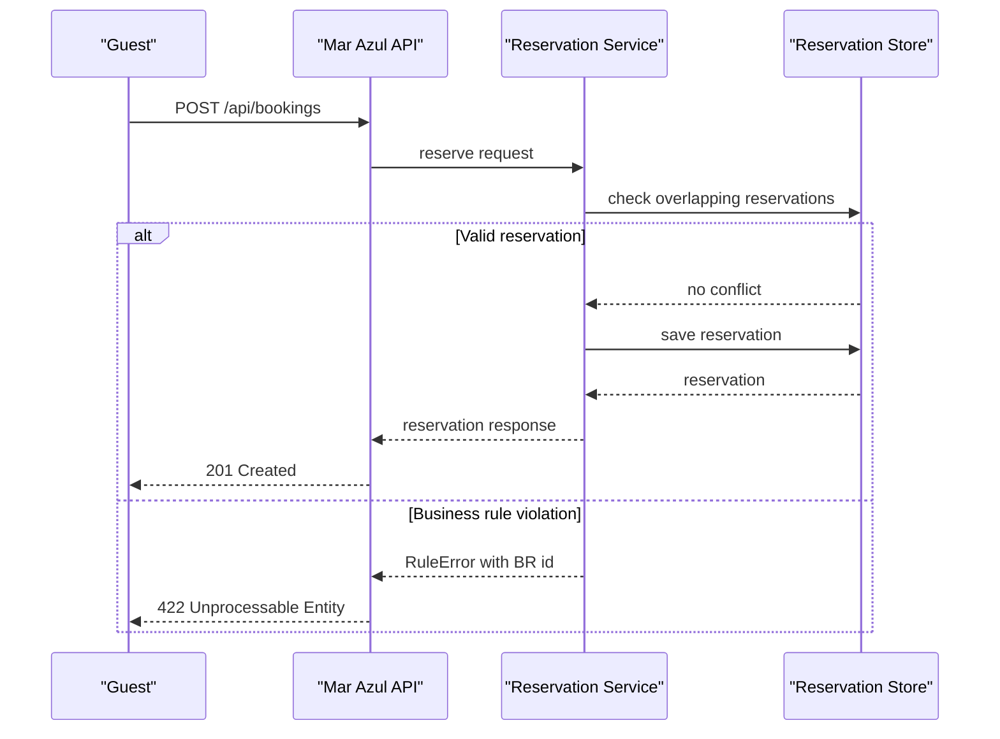

# API & Service Communication Contracts

The initial system exposes a small synchronous REST API and a standalone telemetry process. The reservation flow is currently in-process; the simulator boundary is prepared for asynchronous telemetry integration.

## Service Catalog

| Service | Port | Category | Purpose |
|---|---:|---|---|
| marazul-backend | 8080 | API and business | Reservation and fleet API |
| marazul-frontend | 80/5173 | Client | Responsive web UI |
| telemetry-simulator | 8090 | Integration | Synthetic fleet readings |

## API Endpoints Inventory

| Service | Method | Path | Request type | Response type |
|---|---|---|---|---|
| marazul-backend | POST | `/api/bookings` | `ReservationRequest` | `ReservationResponse` |

## Management & Observability Endpoints

| Service | Endpoint | Custom metrics |
|---|---|---|
| marazul-backend | `/actuator/health` | Spring health status |
| marazul-backend | `/actuator/prometheus` | Micrometer export |

## DTOs & Contracts

`ReservationRequest` is the mutable-at-the-edge request contract and `ReservationResponse` is an immutable Java record returned to clients. `RuleError` preserves the business rule identifier required for test traceability. Domain records are not exposed directly as persistence entities.

## Communication Patterns

The reservation request is synchronous HTTP and uses direct application-service calls. Telemetry is intentionally isolated behind a future port; the simulator is independently deployable and currently exposes a health-shaped JSON response. Authentication and authorization are not implemented in this skeleton and must be added before deployment.

## Service Technology Matrix

| Service | Web | Data access | Discovery | Gateway | Actuator | Cache | Metrics |
|---|---|---|---|---|---|---|---|
| marazul-backend | Spring MVC | In-memory adapters | None | None | Yes | None | Prometheus endpoint |
| marazul-frontend | Vite | None | None | None | None | Browser | None |
| telemetry-simulator | Node HTTP | None | None | None | None | None | None |

## Service Communication Sequence

<!-- mermaid-checked: every participant uses `participant Id as "Label"`, no \n in aliases/messages/notes, every alt/opt/loop closed by end, no `:` inside any alias -->

